<div align="center">

# NovaTrade

**A broker-style practice trading app for Android: live market prices, a full TradingView chart and real-feeling accounts, all with virtual money.**


-3DDC84?logo=android&logoColor=white)


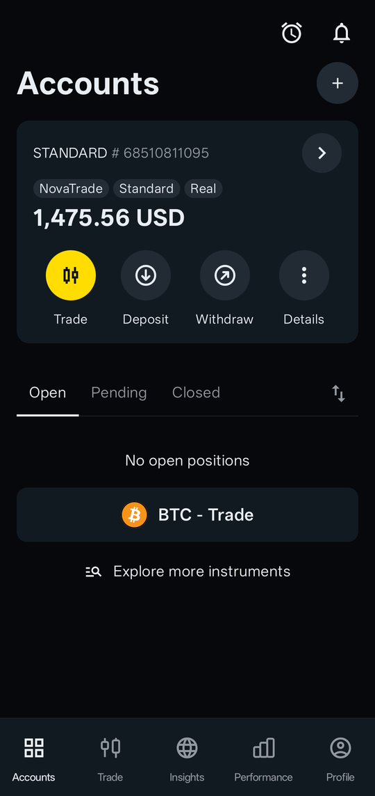
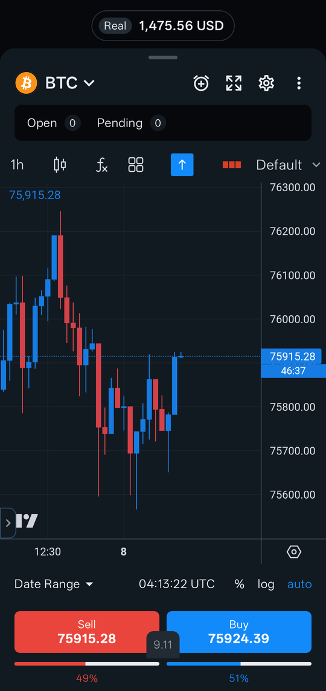
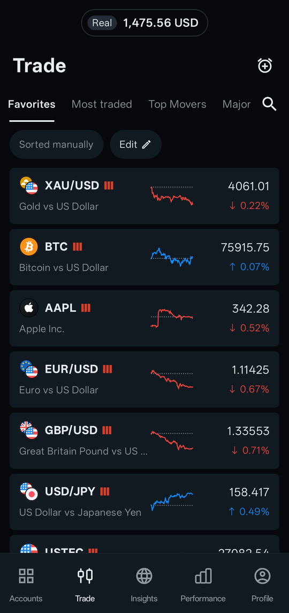

</div>

---

## About

NovaTrade lets you practise trading forex, metals, crypto, indices, stocks and energies on live prices without risking money. Every account, including the ones labelled **Real**, holds virtual funds only: deposits, withdrawals and trades are simulated on the device.

The app is designed to feel like a professional mobile broker: dark theme, account cards, a TradingView chart with drawing tools, one-tap orders with Take Profit and Stop Loss dragged on the chart, and a full account history.

## Features

### Markets and live data
- **100+ instruments** across forex majors, minors and exotics, metals, crypto, indices, stocks and energies, each with its own logo.
- **Live crypto prices** from the Binance WebSocket, with an automatic REST fallback when a network blocks sockets.
- **Forex, metals, indices, stocks and energies** polled from Yahoo Finance, with smooth ticks between polls.
- **Market hours** for forex (Sunday–Friday) and US stocks (09:30–16:00 New York). Orders are refused while a market is closed.

### Charting
- **TradingView Lightweight Charts** embedded in a WebView, with a native Compose toolbar around it.
- **18 chart types:** Bars, Candles, Hollow and Volume candles, HLC bars, Line, Line with markers, Step line, Area, HLC area, Baseline, Columns, High-low, Heikin Ashi, Renko, Line break, Kagi and Point & figure.
- **Timeframes** from 1 minute to 12 months, plus **custom intervals** (e.g. 7 minutes or 3 hours) built from smaller candles. You can star your favourites.
- **Drawing tools:** trend lines, rays, channels, pitchforks, Fibonacci tools, Elliott waves, chart patterns, long/short positions, shapes, text and a brush, all saved per symbol.
- **Price scale menu:**
  - Auto, lock and invert
  - Regular, percent, indexed to 100 and logarithmic modes
  - Scale on the left or right
  - Labels and lines for last price, previous close, high/low and bid/ask
  - Countdown to bar close
  - A plus button that creates a price alert
- **Indicators** (MA 20, MA 50, EMA 20) and **named chart layouts** you can save, copy and rename.

### Trading
- Market and pending (limit/stop) orders, with leverage, margin, free margin and margin level.
- **Take Profit / Stop Loss dragged on the chart.** Changes show as a draft with validation errors, and are saved only after Confirm.
- Partial close, close by an opposite position, and automatic stop out.
- Open, pending and closed tabs. Closed trades are grouped by day with daily P/L and TP / SL / SO tags.

### Accounts
- Several **Real** and **Demo** accounts (virtual money) that you open through a guided product → platform → setup flow.
- **Swipe to archive or restore** accounts.
- **Account details** page:
  - Funds tab with deposit, withdraw, history and transfer
  - Settings tab with type, number, nickname, commission, spread, max leverage and trading log
- **Transaction history** with period and type filters.
- Deposit and withdrawal flows that look like real payment methods. Nothing is ever charged.

### Insights, performance and profile
- Top movers, trading signals, an economic calendar and market news.
- Performance summary with net profit, closed orders and win/loss split.
- Profile with benefits, crypto wallet, settings, price alerts and notifications.

### Security
- **PIN and fingerprint** unlock, with a configurable lock timeout.
- Content hidden from the recent-apps screen, and **flip the phone to hide balances**.

## Screenshots

| Accounts | Account switcher | Closed trades |
| :---: | :---: | :---: |
|  | 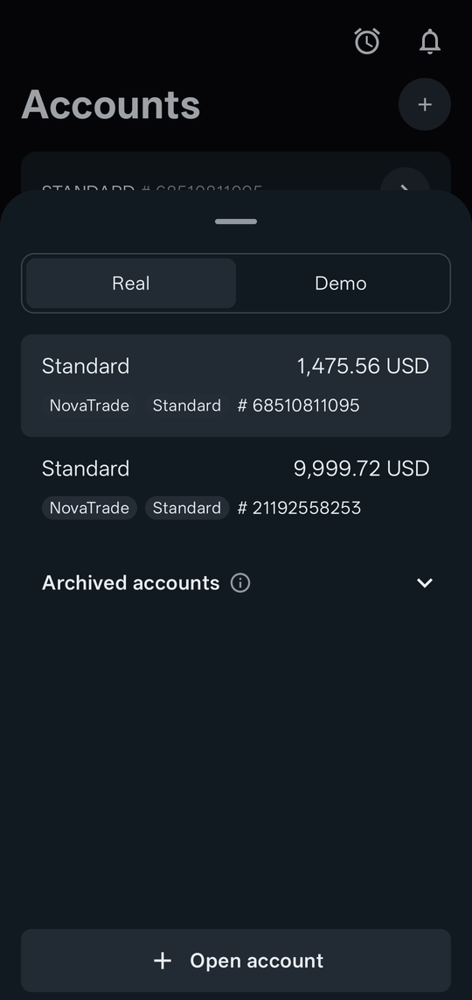 | 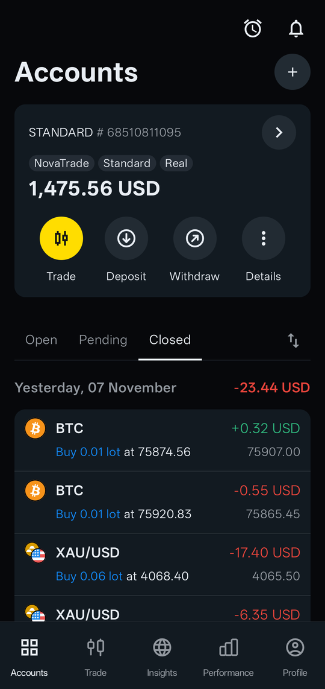 |
| **Account details — Funds** | **Account details — Settings** | **Trade** |
| 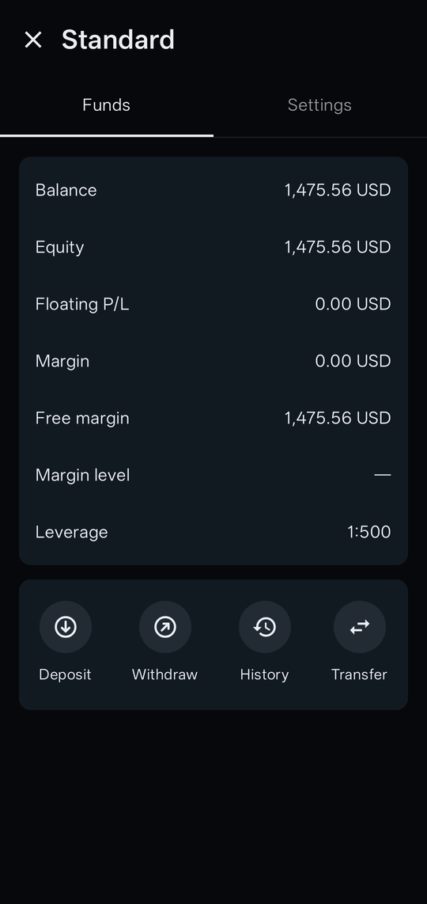 | 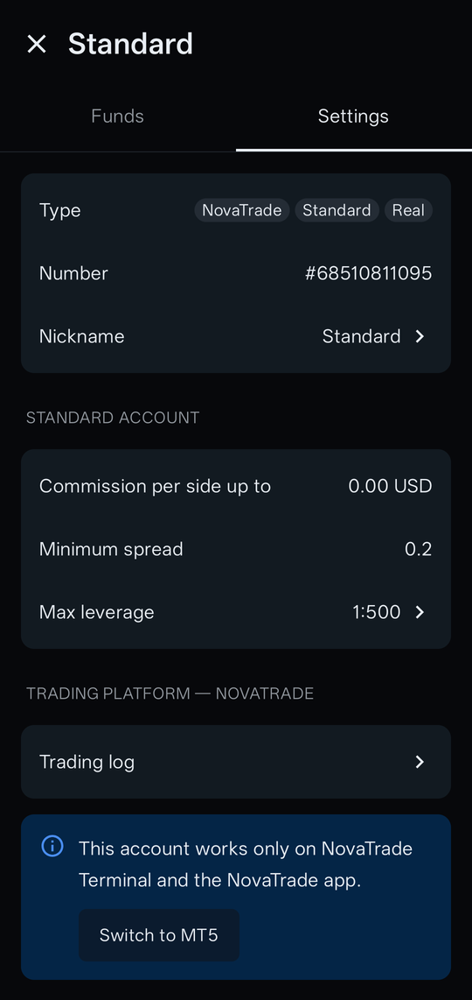 |  |
| **Chart** | **Timeframes** | **Chart types** |
|  | 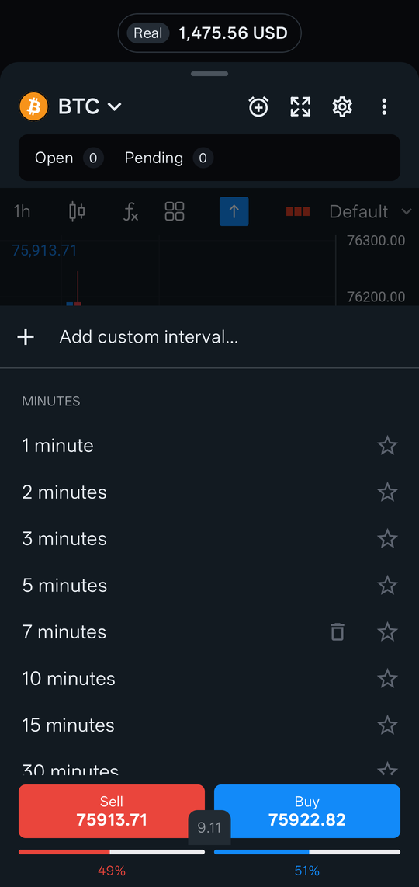 | 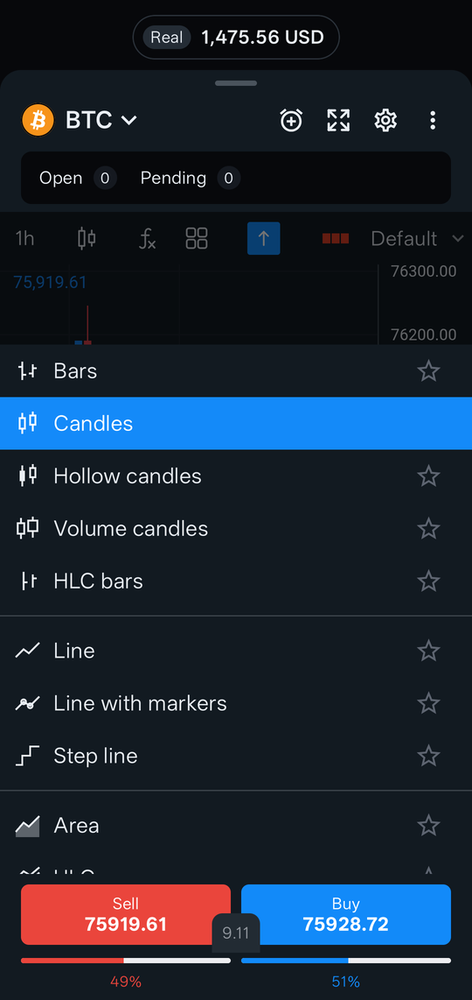 |
| **Price scale settings** | **New order with TP / SL** | **Insights** |
| 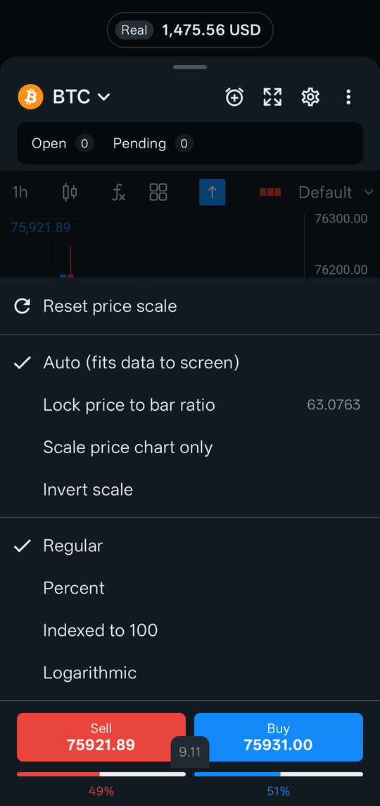 | 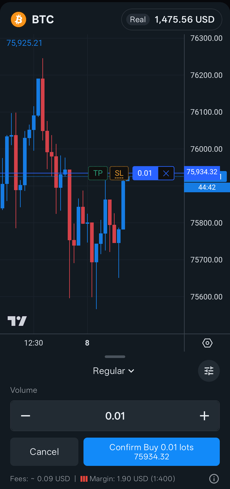 | 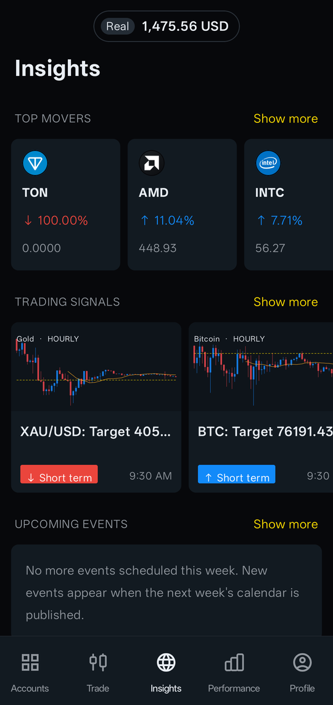 |
| **Performance** | **Profile** | |
| 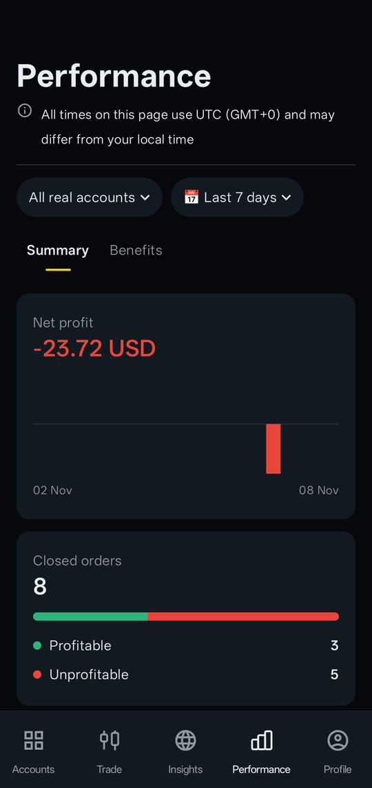 | 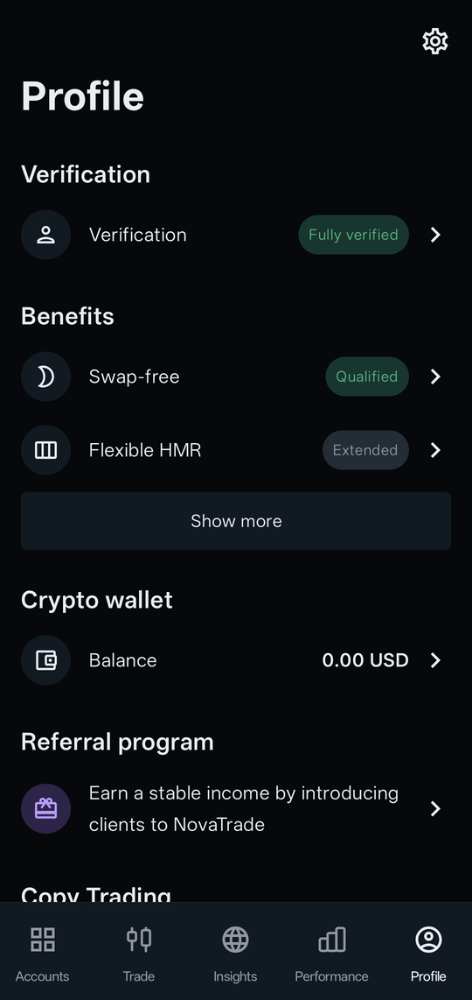 | |

## Using the chart

### Drawing tools

The left toolbar (tap the small arrow at the bottom-left of the chart) holds the cursor and six groups of drawing tools. Tap a group to see its tools, pick one, then tap the chart to place each anchor point. Drag an anchor to move it; tap a drawing to select it and get a toolbar for colour, line width, style, copy and delete. Star a tool to keep it in the favourites bar.

| Left toolbar | Lines and channels | Fibonacci |
| :---: | :---: | :---: |
| 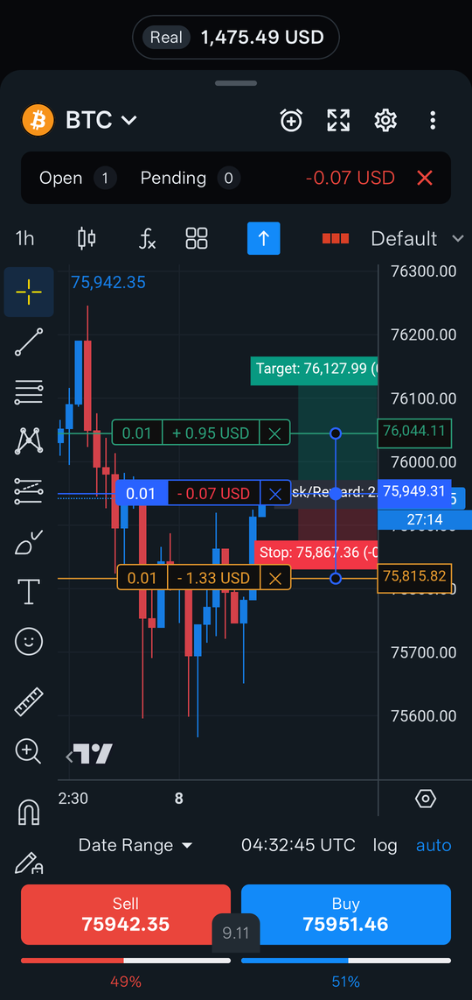 | 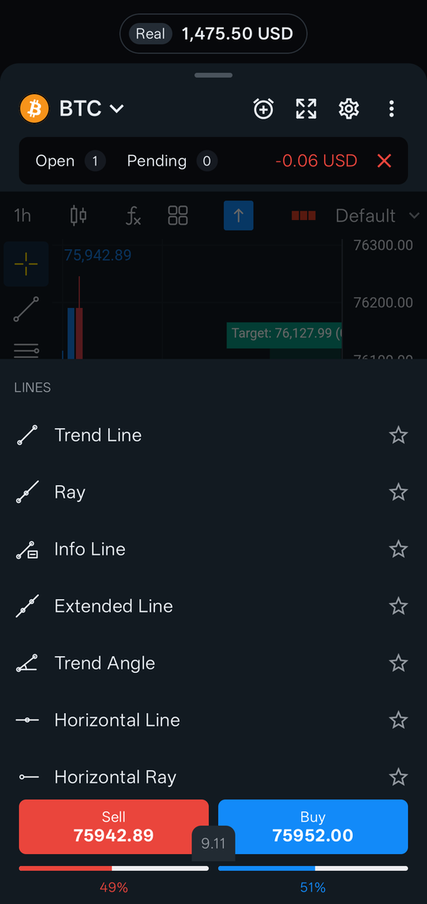 | 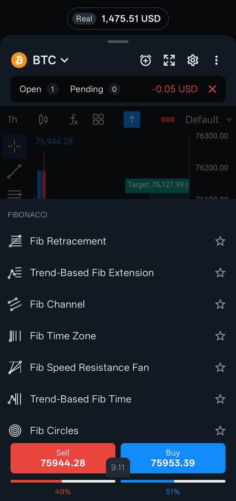 |
| **Patterns and Elliott waves** | **Prediction and measurement** | **Brushes, arrows and shapes** |
| 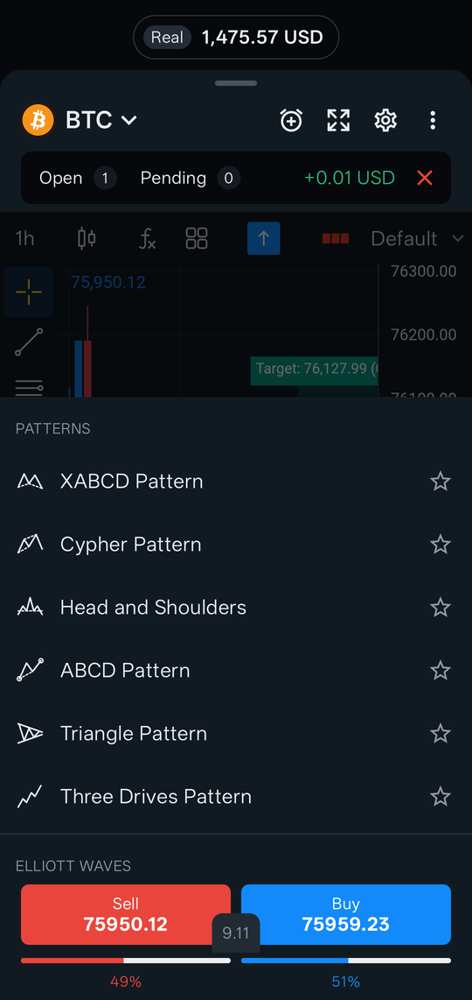 | 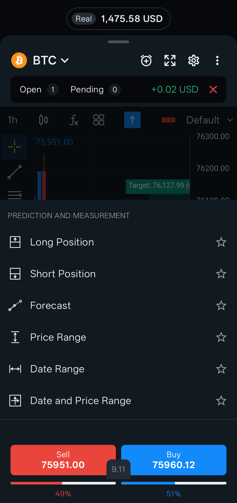 | 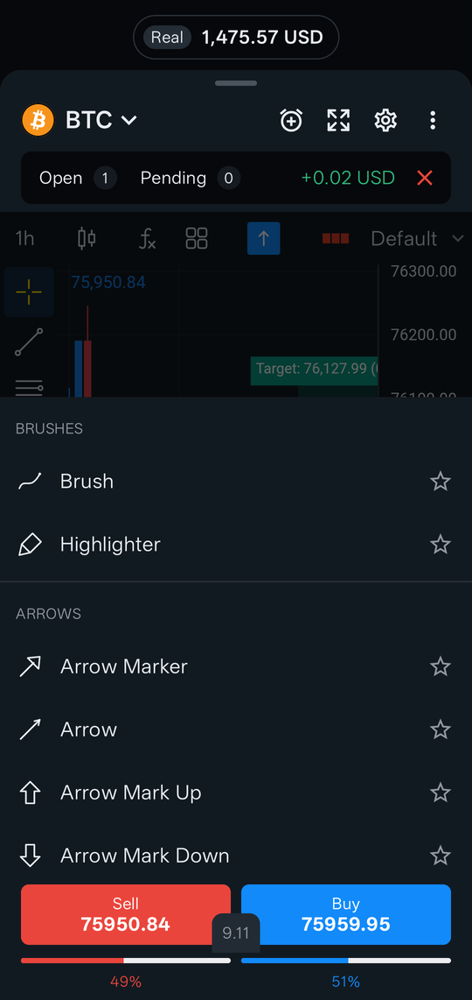 |
| **Text and notes** | **Open position with TP / SL on the chart** | |
| 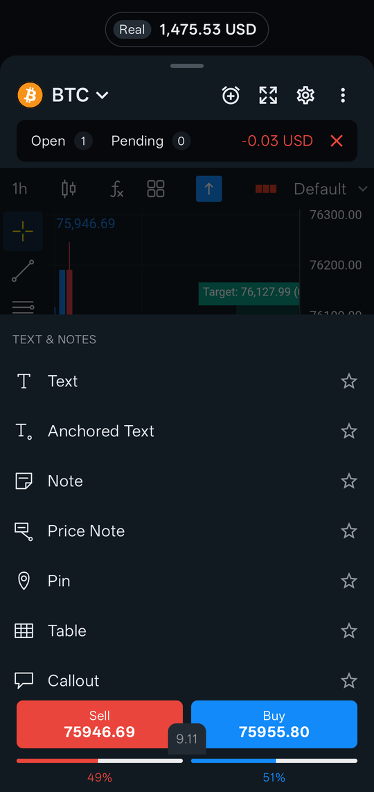 | 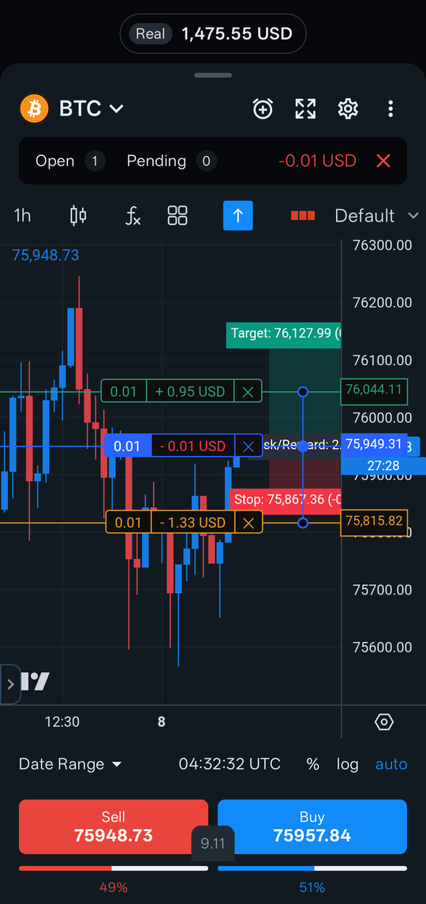 | |

Tips:

- **Long / Short Position:** tap three times for entry, target and stop. Tap elsewhere to hide the labels and keep only the zones; tap a zone to bring the labels and handles back.
- **Measure:** the ruler button (Date and Price Range) shows the price change, percentage, number of bars and time between two points.
- **Magnet:** snaps anchors to candle open, high, low and close.
- **Back** closes an open menu or cancels the tool being placed before it leaves the chart.

### Positions on the chart

An open position is drawn at its entry price with its volume, live P/L and a close button. Its Take Profit and Stop Loss are shown as separate lines: drag one to move it, or drag from the TP / SL tags to add one. Edits show a Cancel / Confirm bar and validation errors (for example, a take profit below the current price on a buy) until they are confirmed.

## Tech stack

| Area | Technology |
| --- | --- |
| Language | Kotlin 2.2 (JVM 17) |
| UI | Jetpack Compose, Material 3, custom Canvas icons |
| State | Kotlin Coroutines and `StateFlow` |
| Networking | OkHttp 4 (REST and WebSocket) |
| Charts | TradingView Lightweight Charts 5, bundled in `assets/chart`, plus a custom drawing engine (`drawings.js`) |
| Storage | `SharedPreferences` and a JSON account book on the device |
| Security | AndroidX Biometric, salted SHA-256 PIN hash, `FLAG_SECURE` |
| Build | Android Gradle Plugin 8.11, compile/target SDK 36, min SDK 26 |

## Architecture

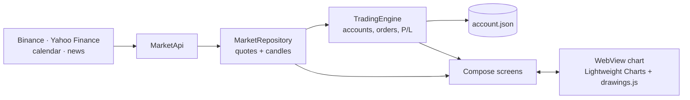

- **`data/`**: market APIs, the market repository (live quotes, candle history, any timeframe) and preferences.
- **`model/`**: instruments, quotes, candles, timeframes, positions and accounts.
- **`trading/`**: the trading engine (orders, margin, TP/SL/stop out, transfers) and account storage.
- **`ui/`**: Compose screens for accounts, trade, insights, performance, profile, the chart and the deposit flows.
- **`assets/chart/`**: the chart page, the chart library and the drawing engine.

The app name lives in one place, `app_name` in `res/values/strings.xml`. Every screen reads it through `Brand`, so renaming the app is a one-line change.

## Getting started

Requirements: Android Studio (latest stable) with JDK 17, and an Android device or emulator on Android 8.0 or newer.

```bash
git clone https://github.com/brijeshch8482/NovaTrade.git
cd NovaTrade
./gradlew installDebug        # build and install on a connected device
./gradlew assembleRelease     # APK in app/build/outputs/apk/release/
```

No API keys are needed: all market data comes from public, key-less endpoints.

## Data sources and credits

- [TradingView Lightweight Charts](https://github.com/tradingview/lightweight-charts) (Apache-2.0) for the chart. Instrument logos come from TradingView's symbol logo service.
- [Binance public market data](https://data-api.binance.vision) for live crypto prices.
- Yahoo Finance chart endpoints for forex, metals, indices, stocks and energies.
- Forex Factory's weekly calendar and the FXStreet news feed for Insights.

## Disclaimer

NovaTrade is an educational and portfolio project. It uses **virtual money only**: no real trades are placed, and no payments are made or accepted. It is not affiliated with, or endorsed by, any broker or exchange. Market data may be delayed or simulated when a source is unavailable.

## Author

Designed and built by **[@brijeshch8482](https://github.com/brijeshch8482)**.
